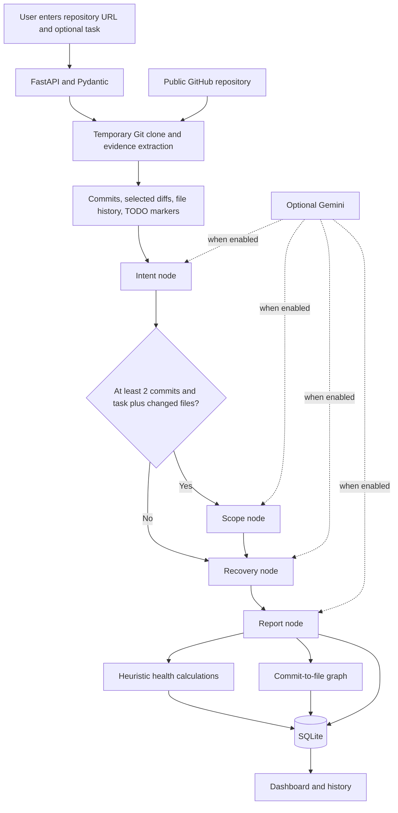
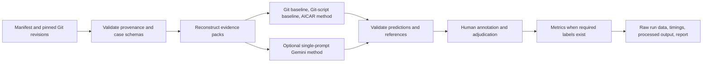

# AICAR — Agentic Intent, Creep, and Recovery

**Research title:** *An Agentic AI Framework for Code Intent Analysis, Scope Creep Detection, and Software Project Recovery*

AICAR is a research-oriented software prototype that collects selected GitHub repository evidence and presents code-intent, task-scope, and project-recovery analyses. The current `main` branch uses a React/Vite frontend, a FastAPI backend, GitPython, LangGraph, and SQLite. Gemini analysis is optional and disabled by default. This branch does **not** implement GitHub OAuth; the `/github/repositories` endpoint returns mock examples.

> **Research integrity:** AICAR is not a validated predictor. The dataset and archived smoke run on this branch have zero human-labelled cases and zero scored cases. No accuracy, precision, recall, F1, nDCG, statistical-significance, time-saving, or comparative-superiority result is established.

## Abstract

Software repositories preserve commits, changed paths, diffs, and file histories, but those artifacts do not directly explain why a change was made, whether it matches a task, or what work may remain in an inactive project. AICAR is a prototype web application that extracts selected Git evidence from public GitHub repositories and organizes analysis into intent, conditional scope, and recovery paths. A LangGraph workflow coordinates these paths and a report step; a React interface displays the result, a heuristic health score, and a commit-to-file graph. Full-analysis results are stored in SQLite and listed in an analysis-history view.

When `USE_GEMINI_ANALYSIS=false`, the application uses offline fallbacks: intent primarily repeats the newest commit message and summarizes changed filenames, scope reports insufficient evidence, and recovery emits a generic recommendation. The scope agent receives changed-file names rather than line- or hunk-level diffs. Health and ranking scores are deterministic heuristics, not calibrated research measures. The separate evaluation pipeline uses pinned Git evidence, baseline methods, annotation schemas, and metric definitions. The archived run contains one repository, seven candidate cases, zero labelled cases, and zero scored cases; it is an unscored smoke run, not a comparative experiment.

## Problem and Motivation

Understanding a repository change can require correlating commit messages, diffs, file history, and task context. Assessing whether an inactive repository is practical to continue also requires more than counting commits. AICAR explores an integrated interface for inspecting these signals while keeping uncertainty visible.

The prototype does not establish that commit messages reveal developer intent, that heuristic scores measure project health, or that model outputs are correct. It is intended to support human review, not replace it.

## Research Objectives

1. Extract selected Git history, changed paths, diffs, file histories, and TODO/FIXME markers from a public GitHub repository.
2. Orchestrate intent, conditional scope, recovery, and report steps through LangGraph.
3. Present analysis, history, repository comparison, and a commit-to-file graph through a web interface.
4. Persist full-analysis results in SQLite.
5. Provide a separate evaluation pipeline that requires human annotation before computing research metrics.

## Implemented Features and Boundaries

| Area | Implementation on this branch | Status / limitation |
|---|---|---|
| Dashboard | React pages for dashboard, history, and comparison | Implemented; frontend build and lint are described in the tracked implementation report |
| Repository extraction | Clone GitHub repository; inspect commit history, selected diffs, file history, TODO/FIXME markers | Implemented; public-repository access requires network and Git |
| Intent | Uses newest commit, changed files, file history, and evidence-map context; optional Gemini prompt | Offline result is primarily commit-message-derived, low-confidence evidence |
| Scope | Compares task text to changed-file names; optional Gemini prompt | No per-hunk or line-level diff evidence is passed to this dashboard agent; offline mode says evidence is insufficient |
| Recovery | Summarizes commit/TODO counts; optional Gemini narrative | Offline recommendation is generic and not calibrated to human recovery judgments |
| Health score | Deterministic deductions based on commit/TODO thresholds and recovery-text substrings | Heuristic, not validated |
| Repository comparison | Analyzes multiple repository URLs and returns per-repository health outputs | Ranking quality is not evaluated; input schema has no declared list-size or uniqueness constraints |
| Project-metric recommendation | Ranks user-supplied project metrics and produces a local or optional Gemini explanation | Not a repository-derived research result |
| Saved history | `/full-analysis` persists an analysis; `/analysis-history` lists records | No individual-record GET route is defined on this branch |
| GitHub repository list | `/github/repositories` returns hardcoded mock examples | Not connected to a user’s GitHub account |
| GitHub OAuth | No OAuth routes or OAuth implementation on this branch | Not implemented here |
| Evaluation package | Pinned-evidence pipeline, baselines, validation, verifier, metrics, reports | Experimental infrastructure; zero labelled cases in the archived run |

These are implementation descriptions, not claims of novelty or superiority over other tools.

## How the Application Works

1. A user submits a GitHub repository URL in the dashboard or through an API route.
2. FastAPI validates request fields using Pydantic models.
3. The repository analyzer clones the repository to a temporary directory and extracts selected recent commits, changed paths, truncated diffs, limited file histories, file counts, and TODO/FIXME markers.
4. `/full-analysis` obtains the repository result and initializes workflow state.
5. The LangGraph path runs intent first. It routes to scope only if there are at least two returned commits and both a task description and changed-file list are present. Recovery and report generation follow.
6. The API computes health measures, builds a graph connecting commits to changed files, saves a full-analysis record in SQLite, and returns the result.
7. The frontend renders the analysis; the history page retrieves the saved list. The comparison endpoint analyzes repositories and returns health outputs.

### Application Workflow



The graph is a change-history representation, not a source dependency graph. The diagram does not imply a live GitHub account connection.

### Separate Evaluation Workflow



This evaluation pipeline is separate from the dashboard workflow and does not create human labels automatically.

## Analysis Details

### Code Intent

The intent node receives the newest commit, file histories, and an evidence map assembled from commit metadata, changed filenames, selected diffs, and file-history records. In offline mode the agent returns the commit message as the likely intent, summarizes changed-file names, reports low confidence, and cites the commit hash. When Gemini is enabled, a prompt requests structured output based on this context. Prompt context is not independent proof that every generated claim is supported.

### Scope-Creep Analysis

The scope request contains `task_description` and a list of `changed_files`. The full-analysis request can receive those values directly. The workflow does not automatically derive the task from an issue/PR, and the live dashboard scope agent is given file names rather than code hunks. Offline mode returns `INSUFFICIENT_EVIDENCE`. The evaluation code supports a separate hunk-based task format, but the current archived candidate cases are unlabelled.

### Recovery Recommendations

Offline recovery text reports the observed commit and TODO/FIXME counts, states “MEDIUM,” and recommends review, automated tests, and deployment-configuration checks. Optional Gemini prompts request an estimate of possible abandonment cause, completion status, remaining work, recovery potential, and a recommendation. Neither path is calibrated against human recovery judgments.

### Health Score

The repository health score in `backend/services/health_score.py` begins at 100 and applies these deductions:

- subtract 15 if total commits are fewer than 5;
- subtract 15 if TODO/FIXME count is greater than 10;
- subtract 10 if recovery text contains `abandoned`;
- subtract 10 if recovery text contains `incomplete`;
- clamp the result to 0–100.

The same service also returns component metrics: `git_activity = min(total_commits × 5, 100)`; `code_completeness = max(0, 100 − 5 × todo_count)`; and `recovery_potential`, starting at 50 and adding 30 when recovery text contains `continue` and 20 when it contains `high potential`, capped at 100. These values are heuristics, not validated measures of completeness or recovery probability.

The separate project-metric recommender calculates a weighted score: 40% activity, 35% of the lower of supplied completion and TODO-derived completeness, and 25% supplied recovery potential. It sorts projects by that score. It is not a research result.

### Repository Comparison, History, and Reports

`POST /compare-repositories` analyzes each supplied URL and returns repository health outputs. It does not persist those comparison results as full-analysis history. `/full-analysis` stores an analysis row, and `/analysis-history` returns saved rows in descending creation time. There is no `/analysis-history/{id}` route in this branch.

The report node combines repository summary and agent outputs. Offline mode produces a template-style report; Gemini mode requests a narrative. The graph renders commit nodes and changed-file nodes with edges for observed changes.

## Technology Stack

| Layer | Technology observed in the branch |
|---|---|
| Frontend | React 19, Vite, JavaScript/TypeScript source, React Router, Axios |
| Graph | `react-force-graph-2d` |
| Backend | Python, FastAPI, Pydantic, Uvicorn, python-dotenv |
| Workflow | LangGraph |
| Git extraction | GitPython and Git |
| Persistence | SQLAlchemy and SQLite |
| Optional model service | Google Gemini via the Google Gen AI SDK |
| Frontend checks | Oxlint, TypeScript build, Vite |
| Evaluation checks | pytest, GitPython, matplotlib |

The repository does **not** contain a backend `requirements.txt` or equivalent pinned runtime dependency manifest. `evaluation/requirements.txt` covers evaluation dependencies; it is not the application backend dependency manifest.

## Project Structure

```text
.
├── backend/
│   ├── agents/                 # Intent, scope, recovery, report, recommendation
│   ├── evaluation/             # Baselines and evaluation runner methods
│   ├── graph/                  # LangGraph application workflow
│   ├── models/                 # Request and SQLAlchemy models
│   ├── services/               # Git evidence, repository extraction, score, LLM
│   ├── database.py
│   └── main.py                 # FastAPI endpoints
├── evaluation/
│   ├── datasets/               # Candidate cases, manifest, evidence
│   ├── reports/                # Evaluation and implementation reports
│   ├── runners/                # Task and full evaluation runners
│   ├── tests/                  # Evaluation tests
│   ├── ANNOTATION_GUIDE.md
│   ├── pipeline.py
│   ├── dataset.py
│   ├── metrics.py
│   └── reporting.py
├── frontend/
│   ├── src/components/
│   ├── src/pages/              # Dashboard, history, comparison
│   ├── package.json
│   └── vite.config.ts          # Development proxy
├── .env.example
├── .gitignore
├── pytest.ini
└── README.md
```

The remote repository currently tracks `backend/code_archaeology.db`. Inspect its contents and provenance before distributing or reusing it; do not put private analysis data in a committed database. The root `.gitignore` excludes `.env`, Python caches, `node_modules`, virtual environments, `*.db` for new/untracked database files, frontend build output, and evaluation repository checkouts.

## Prerequisites and Local Setup

Prerequisites: Python, Node.js/npm compatible with the Vite version, Git on `PATH`, and network access for public GitHub clones. No backend Python version or pinned backend dependency set is declared in this branch.

### Backend

Create a virtual environment and install the runtime packages imported by the backend. Because no backend requirements file exists, the following package list is an unpinned setup aid rather than a repository-locked environment:

```powershell
Set-Location backend
python -m venv .venv
.\.venv\Scripts\Activate.ps1
python -m pip install fastapi uvicorn python-dotenv SQLAlchemy pydantic langgraph GitPython
```

For Command Prompt use `.venv\Scripts\activate.bat`; on macOS/Linux use `source .venv/bin/activate`. Gemini mode additionally requires the Google Gen AI SDK:

```powershell
python -m pip install google-genai
```

The app reads the project-root `.env` file. Copy `.env.example` to the root as `.env` and set only optional model values if required. Start the backend from the `backend` directory:

```powershell
python -m uvicorn main:app --reload --host 127.0.0.1 --port 8000
```

The API root is `http://127.0.0.1:8000/`; Swagger UI is `http://127.0.0.1:8000/docs`.

### Frontend

In another terminal:

```powershell
Set-Location frontend
npm install
npm run dev -- --host 127.0.0.1
```

Open `http://127.0.0.1:5173/`. Vite proxies requests with the `/api` prefix to FastAPI, stripping that prefix.

### Offline Public Repository Demo

1. Keep `USE_GEMINI_ANALYSIS=false` or unset.
2. Start the backend and frontend.
3. Enter a public repository URL, e.g. `https://github.com/octocat/Spoon-Knife`.
4. Optionally provide task text and inspect the outputs and their limitations.
5. Open history to view records saved by full-analysis requests.
6. Use comparison with multiple public repository URLs.

Full-analysis requests create normal saved history records in SQLite. The database URL is hardcoded as `sqlite:///./code_archaeology.db`; when running from `backend`, the database is relative to that working directory. Preserve any existing database data.

## Configuration

The tracked `.env.example` defines:

| Variable | Purpose |
|---|---|
| `USE_GEMINI_ANALYSIS` | Set `true` to enable Gemini-backed agent calls; default is `false` |
| `GEMINI_API_KEY` | Optional Gemini credential, required for live model calls |
| `GEMINI_MODEL` | Explicit Gemini model name required for live calls |

The current branch has no `DATABASE_URL`, GitHub OAuth credential, session-signing, token-encryption, or frontend-origin settings in `.env.example`. Do not assume OAuth or private-repository access is supported by this branch.

## API Endpoints

Request models are defined in `backend/models/requests.py`; inspect `/docs` or `/openapi.json` for the running service's schema.

| Method | Route | Request / behavior | Side effect |
|---|---|---|---|
| `GET` | `/` | Backend status message | None |
| `GET` | `/github/repositories` | Returns a hardcoded mock list, not account repositories | None |
| `POST` | `/analyze` | `{"github_url":"https://github.com/owner/repository"}`; extracts and analyzes repository | No full-analysis record |
| `POST` | `/analyze-scope` | `{"task_description":"...","changed_files":["src/file.ts"]}` | None |
| `POST` | `/full-analysis` | `{"github_url":"...","task_description":"optional","changed_files":["optional/path"]}` | Saves an analysis-history record |
| `POST` | `/recommend-project` | `{"projects":[...]}`; accepts project-metric objects | None |
| `POST` | `/compare-repositories` | `{"repositories":["https://github.com/owner/repo1","https://github.com/owner/repo2"]}` | No full-analysis record |
| `GET` | `/analysis-history` | Returns all saved analysis records | Read only |

The request models on this branch use Pydantic `HttpUrl` for repository URLs. Scope fields are basic strings/lists without the stricter bounds present in other development snapshots. The repository comparison model declares a list of strings without a minimum or maximum length. Check the actual Swagger schema before relying on further constraints.

## Testing and Verification

Verification evidence must be tied to the code snapshot that was tested:

| Evidence | Result | Applicability |
|---|---|---|
| Remote branch `main`, archived evaluation run `20260922T172449_3f6dec5e` | `unscored_smoke`; 21 offline executions, 21 successes, 0 errors, 7 skipped, 0 scored cases | Recorded artifact, not a current rerun or research result |
| Remote branch `evaluation/reports/implementation_summary.md` | Reports 33 Python tests and frontend lint/build success | Historical report; not independently rerun here |
| Separate local workspace verification, 22 October 2026 | 47 Python tests and 10 frontend tests passed; lint/build passed | That workspace had different code from remote `main`; these counts must not be represented as remote-branch test results |
| Frontend test script on remote `main` | No `test` script or frontend test files in its package/source tree | `npm test` is not available on this branch |
| Backend dependency manifest on remote `main` | No `backend/requirements.txt` | The app runtime install is not pinned by this branch |
| Gemini / GitHub account integration | Not verified | No end-to-end credentials/configuration evidence |

Commands declared by remote `main`:

```powershell
# Backend/evaluation tests (requires Python dependencies)
python -m pytest -q

# Frontend
Set-Location frontend
npm run lint
npm run build
```

The root `pytest.ini` sets `testpaths = evaluation/tests`. Evaluation dependencies are listed in `evaluation/requirements.txt`. Do not interpret an unscored smoke run or software test pass count as research accuracy.

## Evaluation Methodology and Status

The separate evaluation pipeline uses repository manifests with pinned revisions, validates evidence/case schemas, reconstructs Git evidence packs, runs offline baselines and the AICAR evaluation method, validates output schemas, audits references/extractive quotations, and writes run artifacts. Optional live Gemini evaluation is a distinct mode. Human annotation is required before a scored run; predictions are not used as labels.

### Dataset and Archived Run on This Branch

The archived run in `evaluation/reports/evaluation_report.md` records:

| Item | Count/status |
|---|---:|
| Repositories | 1 |
| Reachable commits at pinned revision | 4 |
| Intent candidates | 3 |
| Scope candidates | 3 |
| Recovery candidates | 1 |
| Total candidates | 7 |
| Human-labelled cases | 0 |
| Scored cases | 0 |
| Run status | `unscored_smoke` |

The annotation guide lists larger proposed design targets (25 repositories, 40 intent, 30 scope, 20 recovery, approximately 1,800 commits). They are targets, not current data or a statistical power guarantee.

### Metric Definitions

When sufficient human labels exist, the pipeline defines normalized exact-match intent accuracy, introducing-commit accuracy, scope precision/recall/F1 with documented unclear handling, graded recovery nDCG, and a limited exact-extractive evidence-support rate. Their definitions are not measured results. With no labels, metrics are unavailable (`null`/N/A), not zero.

### Reproducibility Commands

The archived evaluation instructions use:

```powershell
python -m pip install -r evaluation/requirements.txt
python -m pytest -q
python evaluation/runners/run_all.py --smoke
```

The smoke command writes new artifacts under `evaluation/results/`. A scored run requires complete human annotation for the selected cases. Live mode additionally needs `GEMINI_API_KEY` and `GEMINI_MODEL`; record model and environment details separately.

## Limitations

- Offline intent is chiefly commit-message extraction, not validated intent reconstruction.
- Dashboard scope analysis receives file names, not per-hunk code.
- Recovery recommendations and health measures are generic or heuristic and uncalibrated.
- The GitHub repository-list endpoint contains mock data; OAuth is not implemented on this branch.
- The evaluation dataset has zero labelled cases; effectiveness has not been established.
- Gemini use requires credentials and a model setting; live use is not verified by the archived offline run.
- There is no pinned backend runtime dependency manifest.
- Database configuration is hardcoded to a relative SQLite path. The remote repository tracks `backend/code_archaeology.db`; inspect its contents and provenance before distribution, and never store private data in a published database.
- No production deployment, user study, statistical comparison, or superiority claim is established.

## Security and Data Handling

- Never commit `.env`, API keys, tokens, or private repository contents.
- Analyze only repositories you are authorized to access. Public cloning consumes network, disk, and time.
- The current branch does not implement GitHub OAuth or private-repository credentials.
- The API has no demonstrated multi-user authorization model; keep local development bound to loopback and do not expose it publicly without appropriate access controls.
- Preserve existing SQLite data. Use a separate clean checkout/database for demos rather than resetting or replacing a database.
- Review staged file lists before commits. In particular, note that a database file is already tracked on remote `main`.

## Future Work

These items are proposed, not completed capabilities:

1. Annotate the candidate cases with human-reviewed, evidence-linked labels.
2. Run scored evaluations and report all failures and unavailable metrics.
3. Give dashboard scope analysis task-source evidence and actual code hunks.
4. Integrate claim-support verification into the live workflow.
5. Calibrate or rename recovery and health measures using independent judgments.
6. Add a pinned backend dependency manifest and reproducible environment setup.
7. Implement and verify authenticated GitHub access if private-repository workflows remain in scope.
8. Add production authorization, deployment, and database-migration controls.

## Citation and Acknowledgement

Verified background reference:

G. Avelino, E. Constantinou, M. T. Valente, and A. Serebrenik, “On the abandonment and survival of open source projects: An empirical investigation,” *arXiv preprint arXiv:1906.08058*, 2019. [Online]. Available: https://arxiv.org/abs/1906.08058.

Other citations in draft research documents need bibliographic verification before they are added here. Acknowledgements should name only people or organizations that actually contributed.

## Screenshots

The tracked frontend includes a hero image asset, but no verified screenshots of the running application were identified for this README. Add genuine captures only after recording them from the actual application; do not present mockups as functional evidence.

## License

No root license file is present in the inspected branch. No license is asserted here.
