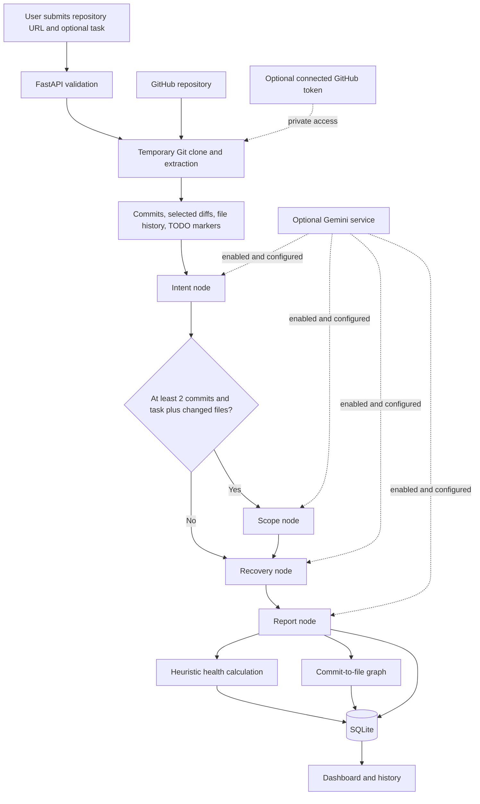
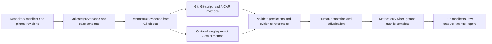

# AICAR — Agentic Intent, Creep, and Recovery

**Research title:** *An Agentic AI Framework for Code Intent Analysis, Scope Creep Detection, and Software Project Recovery*

AICAR is a research-oriented software prototype for exploring why repository code changes exist, whether changes correspond to a task, and what evidence may inform recovery of an unfinished project. It combines Git-based repository extraction, a conditional LangGraph workflow, a React dashboard, SQLite persistence, and optional Gemini and GitHub OAuth integrations.

> **Research integrity:** This is an implemented prototype, not a validated predictive system. The working evaluation dataset contains 50 candidate cases and zero human-labelled cases. The archived smoke run scored zero cases. No accuracy, precision, recall, F1, nDCG, statistical-significance, time-saving, or superiority result is established.

## Abstract

Software repositories preserve commits, changed paths, diffs, and file histories, but these records do not by themselves explain why code was introduced, whether a patch matches an intended task, or what work may remain in an inactive project. AICAR collects selected repository evidence and presents intent, scope, and recovery analysis paths in one web application. The frontend uses React 19, TypeScript, Vite, React Router, and Axios; the backend uses FastAPI, Pydantic, SQLAlchemy/SQLite, GitPython, and LangGraph. Optional Gemini calls provide model-assisted narratives, and optional GitHub OAuth supports account-linked repository access.

The full-analysis workflow extracts Git evidence, invokes intent analysis, conditionally invokes scope analysis, invokes recovery analysis, builds a report, calculates code-defined health heuristics, creates a commit-to-file graph, and persists the result. Offline behavior is available but limited: intent is primarily based on the newest commit message, the dashboard scope agent receives changed-file names rather than code hunks, and recovery and health outputs are not calibrated. A separate evaluation pipeline operates on pinned Git evidence and requires human annotations before scoring. Its working dataset contains 9 repositories, 566 reachable commits, 23 intent cases, 18 scope cases, and 9 recovery candidates; all 50 cases are pending annotation. This report describes software behavior and does not claim research effectiveness.

## Problem and Motivation

Understanding a repository change can require correlating commit messages, diffs, file history, and task context. Determining whether a project is practical to continue also requires examining available evidence rather than assuming that activity, TODO counts, or a model-generated recommendation measure viability. AICAR explores a unified interface for these software-maintenance questions while leaving final judgment to developers.

## Research Objectives

1. Extract selected commits, diffs, file histories, and TODO/FIXME markers from GitHub repositories.
2. Organize intent, conditional scope, recovery, and report steps using a LangGraph application workflow.
3. Present results, graph data, history, and repository comparison through a browser dashboard.
4. Persist full-analysis results in SQLite.
5. Provide separate research-evaluation tooling with pinned evidence, baselines, validators, and metrics that require human labels.

## Implemented Features and Boundaries

| Area | Implementation | Status and limitation |
|---|---|---|
| Dashboard, history, comparison | React pages connected to the FastAPI API | Implemented; exercised during local demo verification |
| Repository extraction | Clone and inspect Git history, selected diffs, file history, and TODO/FIXME markers | Implemented with limits; public GitHub access requires network |
| Intent analysis | Latest commit context and evidence map; optional Gemini prompt | Offline result is largely commit-message-derived and low-confidence |
| Scope analysis | Optional task text and changed-file names; optional Gemini prompt | Dashboard workflow does not pass per-hunk code evidence; offline result reports insufficient evidence |
| Recovery | Summary and recommendation; optional Gemini narrative | Offline text is generic; no calibrated recovery measure |
| Health score | Weighted heuristic from commit activity, TODO count, and recovery text | Implemented, not calibrated or research-validated |
| Repository comparison | Analyze multiple repositories and rank successful results using heuristic scores | Working workflow; ranking quality is not validated |
| History/report | Save full-analysis result, generate report, list and reload analyses | Implemented; database is local SQLite |
| GitHub OAuth | Optional OAuth callback, signed state, encrypted stored token, repository listing | Code is implemented; real OAuth exchange was not verified in the demo |
| Gemini | Optional provider calls when explicitly enabled and configured | Not verified end-to-end in the demo; offline fallback was used |
| Evaluation pipeline | Pinned evidence, Git/Git-script baselines, AICAR method, schema validation, evidence checks, metrics | Experimental infrastructure; no labelled cases or scored results |

These are implementation descriptions, not claims of research novelty or superiority.

## How AICAR Works

1. A user supplies a GitHub repository URL, with an optional task description.
2. FastAPI validates the request. The repository analyzer clones the repository to a temporary directory and extracts selected recent commits, changed paths, diffs, file histories, and TODO/FIXME markers.
3. The full-analysis endpoint constructs workflow state and invokes LangGraph:
   - intent analysis runs first;
   - scope runs only if at least two commit entries, a task, and changed files are available;
   - recovery and report steps then run.
4. The backend calculates heuristic health values and creates a graph linking commits to changed files.
5. `/full-analysis` stores the result in SQLite. The frontend displays the result; the history page lists saved analyses.
6. `/compare-repositories` independently analyzes multiple repositories and ranks successful results by heuristic health score.

### Application Workflow



The graph represents commit-to-changed-file relationships, not source-code dependency edges.

### Separate Evaluation Workflow



The evaluation pipeline is separate from the dashboard workflow. It does not generate human labels.

## Analysis Details

### Code Intent

The intent agent receives the newest commit, selected file histories, and an evidence map containing commit, changed-file, diff, and history references. Offline mode primarily reports the commit message as likely intent, summarizes changed filenames, and assigns low confidence. With Gemini enabled, a prompt requests a structured intent explanation based on those inputs. Evidence included in a prompt does not guarantee semantic correctness or independently verified claim support.

### Scope-Creep Analysis

The task may be entered by the user. If a task is supplied without an explicit changed-file list, `/full-analysis` can use changed files from the newest commit. The application scope agent receives filenames, not line-level or hunk-level diff evidence. Offline mode reports `INSUFFICIENT_EVIDENCE`. The separate evaluator includes hunk-oriented cases, but its labels remain pending and those cases are not the live dashboard implementation.

### Recovery Recommendations

Offline recovery output reports commit/TODO counts, gives a generic “MEDIUM” assessment, and recommends review. The optional Gemini prompt requests a narrative about possible abandonment cause, completion status, remaining work, recovery potential, and a recommendation. Neither path is calibrated against human recovery judgments.

### Health Score and Project Ranking

The repository-health service computes:

- `git_activity = min(total_commits × 5, 100)`
- `code_completeness = max(0, 100 − 5 × todo_count)`
- `recovery_potential`: starts at 50; adds 30 if recovery text contains `continue` and 20 if it contains `high potential`, capped at 100
- `health_score = round(0.40 × git_activity + 0.35 × code_completeness + 0.25 × recovery_potential, 2)`

These values are implementation-defined heuristics, not scientifically validated measures of project quality, completion, or recovery probability.

The separate `/recommend-project` endpoint ranks user-supplied project metrics using activity, completion constrained by TODO-derived completeness, and recovery-potential inputs (weights 40%, 35%, and 25%). It is not a repository-derived research result.

### Graph, History, and Reports

The graph contains commit nodes, changed-file nodes, and edges for observed commit/file changes. The report agent combines repository and agent outputs; offline mode produces a template-style report, while configured Gemini mode requests a narrative.

`/full-analysis` saves the result in SQLite. `/analysis-history` lists saved analyses, and `/analysis-history/{analysis_id}` retrieves a saved result. `/analyze` returns extraction and analysis output but does not save a full-analysis record.

## Technology Stack

| Layer | Technology |
|---|---|
| Frontend | React 19, TypeScript, Vite, React Router, Axios |
| Graph visualization | `react-force-graph-2d` |
| Backend/API | Python, FastAPI, Pydantic, Uvicorn |
| Workflow | LangGraph |
| Repository access | Git CLI, GitPython |
| Persistence | SQLAlchemy and SQLite |
| Optional model | Google Gemini through `google-genai` |
| OAuth/security libraries | HTTPX, itsdangerous, cryptography/Fernet |
| Tests/lint/build | pytest, Vitest, Testing Library, Oxlint, TypeScript, Vite |

Backend runtime dependencies are in `backend/requirements.txt`, evaluation-only dependencies in `evaluation/requirements.txt`, and frontend dependencies/scripts in `frontend/package.json`. The installed Vite version requires Node.js `^20.19.0 || >=22.12.0`; use a compatible release.

## Project Structure

```text
.
├── backend/
│   ├── agents/                 # Intent, scope, recovery, report, recommendation
│   ├── graph/                  # LangGraph workflow
│   ├── models/                 # Request and SQLAlchemy models
│   ├── services/               # Git extraction, scoring, graph, OAuth, Gemini
│   ├── evaluation/             # Evaluation method implementations
│   ├── main.py                 # FastAPI application and routes
│   ├── database.py
│   └── requirements.txt
├── frontend/
│   ├── src/components/
│   ├── src/pages/              # Dashboard, history, comparison
│   ├── package.json
│   └── vite.config.ts
├── evaluation/
│   ├── datasets/               # Pinned candidate metadata and evidence
│   ├── tests/
│   ├── runners/
│   ├── results/                # Archived evaluation artifacts
│   ├── reports/
│   ├── ANNOTATION_GUIDE.md
│   ├── pipeline.py
│   ├── dataset.py
│   ├── metrics.py
│   └── reporting.py
├── scripts/smoke_test.py
├── .env.example
├── .gitignore
├── pytest.ini
└── README.md
```

The Git ignore rules exclude environment files, databases, `node_modules`, virtual environments, caches, build output, test temporary directories, and local evaluation repository checkouts. The evaluation repository checkout folders are deliberately not included in this publication; restore approved source repositories at the pinned revisions before running the expanded local dataset.

## Prerequisites and Setup

- Python 3.10 or newer.
- Node.js 20.19+ or 22.12+ and npm.
- Git installed and available on `PATH`.
- Internet access for public GitHub clones.
- Optional Gemini credentials/model for live model calls.
- Optional GitHub OAuth application credentials for account-linked access.

### Backend

From the project root:

```powershell
Set-Location backend
python -m venv .venv
.\.venv\Scripts\Activate.ps1
python -m pip install -r requirements.txt
```

For Command Prompt use `.venv\Scripts\activate.bat`; on macOS/Linux use `source .venv/bin/activate`.

Copy the root environment template to `.env` if configuration is required:

```powershell
Copy-Item ..\.env.example ..\.env
```

Start FastAPI from the `backend` directory:

```powershell
python -m uvicorn main:app --reload --host 127.0.0.1 --port 8000
```

API root: `http://127.0.0.1:8000/`; Swagger UI: `http://127.0.0.1:8000/docs`.

### Frontend

In a second terminal:

```powershell
Set-Location frontend
npm install
npm run dev -- --host 127.0.0.1
```

Open `http://127.0.0.1:5173/`. The Vite development proxy forwards `/api/*` to FastAPI and strips the `/api` prefix.

### Public Repository Demo

1. Keep `USE_GEMINI_ANALYSIS=false` or leave it unset.
2. Start the backend and frontend.
3. Submit `https://github.com/octocat/Spoon-Knife` or another public repository.
4. Optionally enter a task description and review the dashboard outputs, graph, and report.
5. Open history to reload saved full-analysis results.
6. Use comparison with at least two distinct public GitHub repositories.

Full analysis writes to the configured SQLite database. The default database is `backend/code_archaeology.db`. Preserve existing data; use a separate database URL for an isolated demo.

## Environment Variables

The project-root `.env.example` lists these variables:

| Variable | Purpose |
|---|---|
| `GEMINI_API_KEY` | Optional Gemini credential |
| `GEMINI_MODEL` | Explicit Gemini model name for reproducible live calls |
| `USE_GEMINI_ANALYSIS` | `false` by default; set `true` to enable Gemini-backed agent calls |
| `GITHUB_CLIENT_ID` | Optional GitHub OAuth application client ID |
| `GITHUB_CLIENT_SECRET` | Optional GitHub OAuth application secret |
| `GITHUB_REDIRECT_URI` | OAuth callback URL used by the local Vite proxy |
| `GITHUB_SESSION_SECRET` | Signing secret for OAuth state/session handling |
| `GITHUB_TOKEN_ENCRYPTION_KEY` | Fernet key for encrypting stored OAuth tokens |
| `FRONTEND_URL` | Frontend origin used in callback redirects |
| `CORS_ORIGINS` | Comma-separated browser origins allowed by FastAPI |
| `APP_ENV` | `production` enables secure-cookie behavior |

Leave optional values blank if the integration is not being used. Never commit `.env`, tokens, secrets, or encryption keys. OAuth callback configuration should use HTTPS outside local development. The demo did not verify Gemini or OAuth end-to-end.

## API Reference

The live FastAPI Swagger UI at `/docs` and `/openapi.json` is authoritative for request schemas. Paths below are backend routes; frontend development requests use the `/api` proxy prefix.

| Method | Route | Request/behavior | Persistence |
|---|---|---|---|
| `GET` | `/` | Backend status response | None |
| `POST` | `/analyze` | `{"github_url":"https://github.com/owner/repository"}` | No full-analysis record |
| `POST` | `/analyze-scope` | `{"task_description":"...","changed_files":["src/file.ts"]}` | None |
| `POST` | `/full-analysis` | Repository URL and optional task/changed-file list | Saves analysis record |
| `POST` | `/recommend-project` | `{"projects":[{"name":"...","completion_level":0,"todo_count":0,"activity_score":0,"recovery_potential":50}]}` | None |
| `POST` | `/compare-repositories` | `{"repositories":["https://github.com/owner/repo1","https://github.com/owner/repo2"]}` | No full-analysis record |
| `GET` | `/analysis-history` | List saved full-analysis results | Read only |
| `GET` | `/analysis-history/{analysis_id}` | Read one saved result | Read only |
| `GET` | `/github/status` | Current browser-session and OAuth configuration status | Read only |
| `GET` | `/github/login` | Start OAuth; requires configuration | Sets OAuth state/session cookie |
| `GET` | `/github/callback` | Validate state and process provider callback | May save encrypted token |
| `GET` | `/github/repositories` | List repositories for connected session | Read only |
| `POST` | `/github/logout` | Disconnect current session | Removes saved connection |

The project comparison request accepts 2–10 unique GitHub URLs. Repository URL and request size validation are defined in `backend/models/requests.py`. OAuth status being available does not establish a successful OAuth integration.

Example full-analysis body:

```json
{
  "github_url": "https://github.com/octocat/Spoon-Knife",
  "task_description": "Review evidence related to the latest repository change"
}
```

## Testing and Verification

These results were reported from local demo verification on **22 October 2026**. They verify selected software paths, not research accuracy:

| Check | Result | Scope |
|---|---|---|
| Backend Python tests | 47 passed; exit code 0 | Isolated tests/database; provider/network interactions include mocks |
| Frontend tests | 10 passed across 2 files; exit code 0 | Component/UI tests |
| Frontend lint | Passed; exit code 0 | Oxlint |
| TypeScript and production build | Passed; exit code 0 | Build was directed to a temporary output directory |
| Local smoke checks | 6 of 6 passed | Backend health/history/status and frontend routes |
| Public GitHub analysis | Verified live | Public repository clone, report, persistence/history reload |
| Repository comparison | Verified live | Two public repositories; heuristic scores only |
| Gemini live calls | Not verified | Key/model not configured |
| GitHub OAuth | Not verified end-to-end | OAuth credentials not configured |

Run the documented checks:

```powershell
# From project root
python -m pytest -q
python scripts/smoke_test.py

# Frontend
Set-Location frontend
npm test
npm run lint
npm run build
```

Frontend tests and production build do not validate research effectiveness.

## Evaluation Dataset and Methodology

The evaluation package is separate from the dashboard. It validates repository provenance and pinned revisions, reconstructs Git evidence packs, runs Git and Git-script baselines alongside an AICAR task-agent method, optionally runs a single-prompt Gemini method, validates prediction schemas, audits evidence references, and computes metrics only when human labels are present.

The expanded local candidate dataset contains:

| Item | Working-tree count | Annotation |
|---|---:|---|
| Registered repositories | 9 | Source/revision records |
| Reachable commits at pins | 566 | Git-derived count |
| Intent candidates | 23 | All pending |
| Scope task/diff candidates | 18 | All pending |
| Recovery candidates | 9 | Eligibility unconfirmed |
| Total candidates | 50 | 0 labelled; 50 pending |

The annotation guide's proposed targets are 25 repositories, 40 intent, 30 scope, 20 recovery, and approximately 1,800 commits. These are targets, not achieved counts. Source repository checkouts and expanded code-derived evidence packs are excluded from this publication; obtain and inspect the approved source repositories at the manifest's pinned revisions before running the expanded dataset. The tracked public branch retains its previous, smaller evaluation data.

Archived run `20261014T152850_5739f230` is `unscored_smoke`: 200 attempts, 150 executed and successful calls, 0 errors, 50 skipped, and 0 scored cases. Gemini was disabled. The run demonstrates selected offline execution only. Metric values are unavailable (`null`), not zero.

Metric definitions include normalized exact-match intent accuracy, introducing-commit accuracy, scope precision/recall/F1 with unclear-label handling, recovery nDCG, and an exact-extractive evidence-support measure. Metric definitions are not results; no labels currently support a research score.

### Reproducibility

```powershell
python -m pip install -r evaluation/requirements.txt
python -m pytest -q
python evaluation/runners/run_all.py --smoke
```

The smoke command writes artifacts under `evaluation/results/`. A scored run requires completing the human annotation workflow in `evaluation/ANNOTATION_GUIDE.md`; do not treat the smoke run as a comparative experiment. Live evaluation additionally requires `GEMINI_API_KEY` and `GEMINI_MODEL`.

## Limitations

- Offline intent is primarily commit-message evidence, not semantic reconstruction.
- Dashboard scope uses filenames rather than per-hunk code evidence; offline output abstains.
- Offline recovery output is generic and health/recommendation scores are uncalibrated.
- The separate evidence verifier is not integrated into the live dashboard workflow.
- The expanded evaluation candidates have zero labels; research effectiveness is unvalidated.
- Gemini and real GitHub OAuth were not tested end-to-end in the reported demo.
- Clone/resource limits and production hardening need further review.
- History is not a complete multi-user authorization system. Keep the development server bound to loopback unless proper deployment access controls are added.
- A successful local test/build does not establish production readiness or research validity.

## Security and Data Handling

- Keep `.env`, model keys, OAuth credentials, signing secrets, encryption keys, and tokens private.
- Analyze only repositories you are authorized to inspect. Repository cloning consumes network, disk, and time.
- OAuth tokens are encrypted at rest in the implemented connection model, but this does not by itself establish production security.
- Use HTTPS and restrictive CORS origins in a deployment. Do not expose the local development API publicly without authentication/authorization and operational controls.
- Preserve SQLite databases and evaluation data. Do not reset or overwrite a database to prepare a demonstration.
- Expanded evaluation source checkouts are not included in this publication; review their licenses and provenance before redistribution.

## Future Work

1. Complete evidence-linked human annotations and confirm recovery-case eligibility.
2. Run scored, reproducible evaluations against the defined baselines.
3. Provide actual diff hunks and task-source evidence to dashboard scope analysis.
4. Integrate claim verification into the live workflow and evaluate semantic support.
5. Calibrate or rename health/recovery measures using independent human judgments.
6. Validate Gemini and GitHub OAuth end-to-end with controlled credentials.
7. Add production authorization, database migrations, and stronger clone/resource isolation.

These are proposed enhancements, not claims of current capability.

## Citation and Acknowledgement

Verified background reference:

G. Avelino, E. Constantinou, M. T. Valente, and A. Serebrenik, “On the abandonment and survival of open source projects: An empirical investigation,” *arXiv preprint arXiv:1906.08058*, 2019. [Online]. Available: https://arxiv.org/abs/1906.08058.

Other references in the research drafts require manual bibliographic verification before publication. Add acknowledgements only for people or organizations who actually contributed.

## Screenshots

No genuine screenshots of the running application are included. Add real captures only after capturing them from the application; do not use mockups as evidence of working functionality.

## License

No root license file is present. This README does not assert a license.
