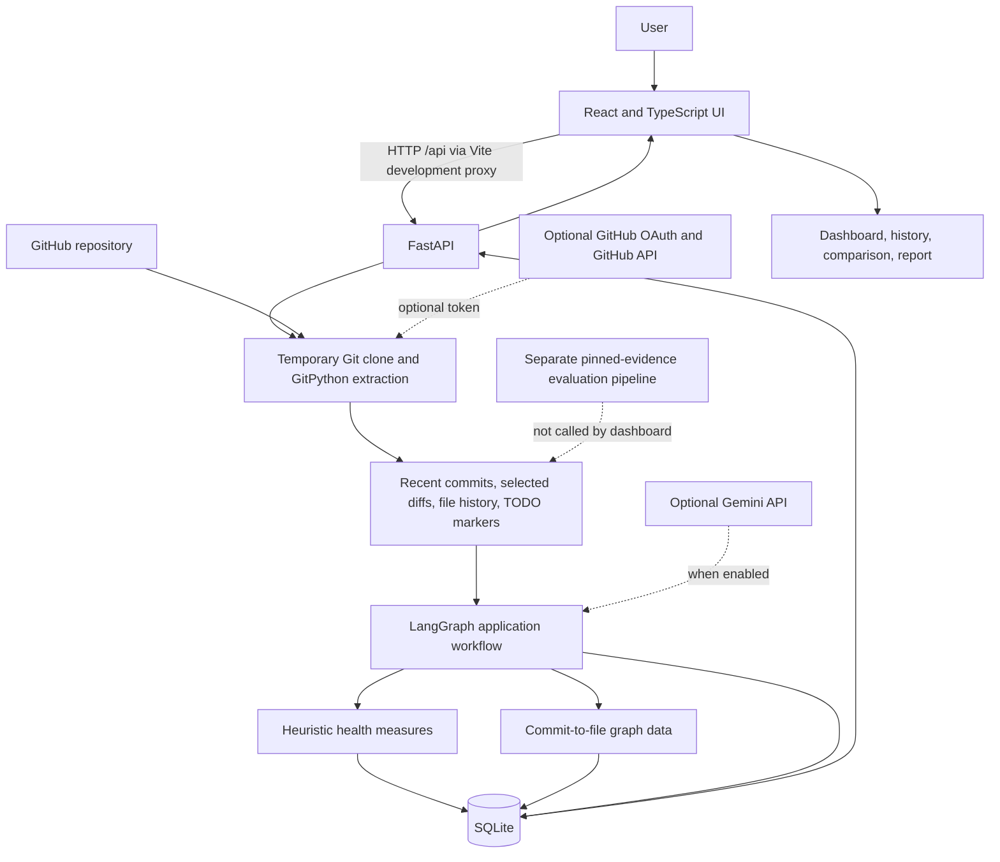
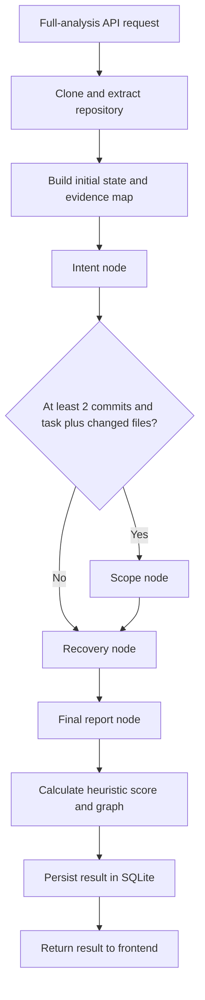

# AICAR: Agentic Intent, Creep, and Recovery
## An Agentic AI Framework for Code Intent Analysis, Scope Creep Detection, and Software Project Recovery

### Final-Year B.Tech Project Report

**Department of Computer Science and Engineering**

**[College / University Name]**

**Academic Year:** [Insert academic year]

**Submitted by:** [Student name(s) and roll number(s)]

**Project guide:** [Guide name and designation]

**Head of Department:** [Name and designation]

**Submission date:** [Insert date]

> **Submission note:** Replace bracketed fields with institution-approved details. Do not add signatures, approvals, acknowledgements, or institutional claims until confirmed by the relevant people.

---

## Certificate

> **PLACEHOLDER — Faculty/institution to complete and approve.**
>
> Insert the official certificate text required by the college, student names and registration numbers, project title, guide and department details, date, and authorized signatures. No approval is asserted by this draft.

## Declaration

> **PLACEHOLDER — Student(s) to review, complete, and sign.**
>
> Insert the declaration required by the college. Confirm authorship, project contribution, permitted reuse, and any required statement about AI tools or external services before signing.

## Acknowledgements

> **PLACEHOLDER — Student(s) to write.**
>
> Add only people and organizations whom the student(s) wish to acknowledge and who have actually contributed or provided support.

## Abstract

Software repositories preserve commits, diffs, and file histories, but these artifacts do not directly explain why code was introduced, whether a change matched an intended task, or what work may remain in an inactive project. AICAR (Agentic Intent, Creep, and Recovery) is a prototype that brings these repository-maintenance questions into a web application. It uses a React and TypeScript frontend, a FastAPI backend, GitPython-based repository extraction, a conditional LangGraph workflow, SQLite persistence, and optional Gemini and GitHub OAuth integrations.

The application extracts recent commits, selected diffs, limited file histories, and TODO/FIXME markers. Its workflow invokes intent analysis, conditionally invokes scope analysis, invokes recovery analysis, and generates a report. The result includes heuristic health measures and a graph linking commits to changed files. Offline operation is available, but its fallbacks are deliberately limited: intent is primarily derived from the latest commit message, scope receives changed-file names rather than per-hunk code evidence, and recovery/health values are uncalibrated heuristics. A separate evaluation pipeline prepares evidence from pinned Git revisions and supports baselines and metrics; it is distinct from the dashboard workflow.

The active evaluation dataset contains 9 repositories and 50 candidate cases: 23 intent, 18 scope, and 9 recovery. All 50 cases are pending human annotation. An archived offline smoke run completed 150 method executions with no scored cases; it is not a comparative performance experiment. Reported software verification includes 47 passing Python tests, 10 passing frontend tests, passing frontend lint and production build, six passing local smoke checks, and a live demonstration of public-repository analysis, saved history, report generation, and comparison. Real Gemini and GitHub OAuth exchanges were not verified because credentials were not configured.

The results establish selected software functionality, not research effectiveness. This report makes no claim of measured intent accuracy, scope precision/recall/F1, recovery nDCG, statistical significance, time savings, or superiority over baselines.

**Keywords:** software repository analysis, code intent, scope creep detection, project recovery, Git, multi-agent workflow, software maintenance.

## Contents

1. [List of Figures and Tables](#list-of-figures-and-tables)
2. [Chapter 1 — Introduction](#chapter-1--introduction)
3. [Chapter 2 — Problem Statement, Objectives, and Scope](#chapter-2--problem-statement-objectives-and-scope)
4. [Chapter 3 — Literature Review and Related Work](#chapter-3--literature-review-and-related-work)
5. [Chapter 4 — System Requirements and Feasibility](#chapter-4--system-requirements-and-feasibility)
6. [Chapter 5 — System Architecture and Design](#chapter-5--system-architecture-and-design)
7. [Chapter 6 — Methodology and Implementation](#chapter-6--methodology-and-implementation)
8. [Chapter 7 — Testing and Verification](#chapter-7--testing-and-verification)
9. [Chapter 8 — Experimental Setup and Evaluation](#chapter-8--experimental-setup-and-evaluation)
10. [Chapter 9 — Results, Limitations, and Discussion](#chapter-9--results-limitations-and-discussion)
11. [Chapter 10 — Conclusion and Future Enhancements](#chapter-10--conclusion-and-future-enhancements)
12. [References](#references)
13. [Appendices](#appendices)

## List of Figures and Tables

### Figures

- **Figure 5.1.** AICAR application architecture and external-service boundaries.
- **Figure 5.2.** Implemented full-analysis LangGraph control flow.
- **Figure A.1–A.6.** Screenshot placeholders to be captured from the running application; these images are not included in this draft.

### Tables

- **Table 3.1.** Related work and its relevance to AICAR.
- **Table 4.1.** Software and service requirements.
- **Table 5.1.** Main system modules and implementation status.
- **Table 5.2.** Backend API routes relevant to the application.
- **Table 5.3.** Persisted database entities.
- **Table 7.1.** Reported software verification results.
- **Table 8.1.** Active evaluation dataset and annotation status.
- **Table 8.2.** Archived unscored smoke-run record.
- **Table 9.1.** Verified capabilities and principal limitations.
- **Table C.1.** Archived evaluation record.
- **Table D.1.** Submission placeholders requiring student or faculty input.

# Chapter 1 — Introduction

## 1.1 Background

Version-control systems record how software changes over time. Commit messages, changed paths, diffs, and file history are useful for reconstructing project evolution, but they do not always answer higher-level maintenance questions. A developer returning to a codebase may need to infer why a particular change exists, whether a patch contains work unrelated to its stated task, or whether an inactive project is practical to continue.

These questions involve different forms of evidence. Intent analysis concerns commit context and code evolution. Scope review compares a task description with changed code. Recovery assessment considers repository characteristics and remaining work. AICAR was developed as a prototype that presents these activities through a shared repository-analysis interface.

## 1.2 Project Overview

AICAR consists of a web frontend, a Python API, Git repository extraction, a LangGraph application workflow, heuristic health calculations, SQLite persistence, and an independent evaluation package. Users can submit a public GitHub repository URL, optionally provide a task description, inspect an analysis result, reload saved analyses, and compare repository scores. GitHub OAuth and Gemini calls are optional configuration paths.

The application can run without Gemini. In that mode, the output remains useful for demonstrating extraction, the UI, history, graph construction, and report formatting, but its analytic fallbacks are limited. The fallback intent is based on the latest commit message, scope analysis states that filenames alone provide insufficient evidence, and recovery is a generic text assessment. These outputs must not be represented as experimentally validated model judgments.

## 1.3 Motivation

Repository exploration commonly requires switching between Git commands, source files, task records, and project documentation. AICAR's engineering objective is to consolidate selected repository signals and display them in one interface. The system is intended as an exploratory assistant, not an autonomous maintainer or a replacement for human review.

## 1.4 Report Organization

Chapter 2 defines the problem, objectives, and boundaries. Chapter 3 summarizes selected related work. Chapter 4 describes requirements and feasibility. Chapters 5 and 6 document the architecture, data flow, algorithms, APIs, persistence, and implementation. Chapter 7 reports software verification. Chapter 8 describes the evaluation pipeline and actual dataset state. Chapter 9 discusses results and limitations. Chapter 10 concludes and identifies future work.

# Chapter 2 — Problem Statement, Objectives, and Scope

## 2.1 Problem Statement

Developers may find it difficult to infer the rationale behind historical code changes, decide whether a patch matches a task, and estimate the feasibility of resuming an inactive repository. Git history exposes structural facts, but an interpretation of intent, scope, or recovery feasibility requires contextual analysis and human judgment.

The project investigates whether a single prototype can collect selected repository evidence, organize it into intent, scope, and recovery analysis paths, and present the outputs through a dashboard. The implementation is a software prototype; the current dataset does not establish the accuracy or comparative effectiveness of those analyses.

## 2.2 Objectives

The project objectives are:

1. Accept and validate GitHub repository URLs through a web interface and API.
2. Extract selected Git history, diffs, file history, and TODO/FIXME markers.
3. Orchestrate intent, conditional scope, and recovery agents using LangGraph.
4. Compute and display a transparent, code-defined heuristic health score.
5. Visualize commit-to-file changes in a two-dimensional graph.
6. Persist full-analysis results and allow users to reload them.
7. Compare multiple repositories using the implemented heuristic measures.
8. Provide optional GitHub OAuth for repository listing and private-repository access.
9. Provide optional Gemini model calls while retaining a configured offline mode.
10. Maintain a separate, reproducible evaluation pipeline that rejects missing labels instead of fabricating scores.

## 2.3 Scope

The implemented application focuses on GitHub-hosted repositories and the analysis paths described in this report. Repository extraction is bounded in selected ways: the analyzer returns up to ten recent commits, processes selected file diffs, and limits file-history collection. These are not guarantees that clone resource consumption is bounded before the clone completes.

The project does not currently establish:

- reliable semantic intent reconstruction across repositories;
- per-hunk scope classification in the dashboard workflow;
- calibrated project-completion or recovery probabilities;
- a validated recovery ranking;
- automatic semantic proof that each model statement is supported by a citation;
- production-grade multi-user authorization or deployment;
- comparative research performance against baselines.

## 2.4 Assumptions

- Git is installed and reachable from the backend process.
- Public repository analysis requires network access to GitHub.
- Private-repository access requires a correctly configured OAuth application and encryption/signing secrets.
- Live Gemini analysis requires `GEMINI_API_KEY`, `GEMINI_MODEL`, and explicit enablement through `USE_GEMINI_ANALYSIS=true`.
- An absent optional service configuration should result in a visible limitation or offline behavior, not an assumed successful integration.

# Chapter 3 — Literature Review and Related Work

## 3.1 Repository History and Intent

Commit messages, diffs, and file history are common inputs for understanding software evolution. Commit messages can provide rationale, but their quality varies; diffs show changed lines but do not directly establish the task's intended scope. AICAR combines these kinds of evidence in an application workflow, but its live fallback does not independently infer intent beyond the commit message.

## 3.2 Commit Untangling and Collaborative Analysis

Atomizer studies a collaborative multi-agent approach to intent-driven composite-commit untangling [2]. ColaUntangle addresses commit untangling through reasoning about explicit and implicit dependencies among changes [3]. These works are related to repository comprehension, but they solve a neighboring task and are not components of AICAR. Their results are not transferred to or claimed for this project.

## 3.3 Project Abandonment and Survival

Avelino et al. analyzed 1,932 popular GitHub projects and reported that 315 projects (16%) were abandoned by their core maintainers; 128 of those abandoned projects (41%) survived after new core developers assumed maintenance [1]. This work motivates distinguishing maintainer departure from project survival. It does not validate AICAR's health formula or provide labels for the AICAR recovery cases.

## 3.4 Multi-Stage Agent Analysis

A related preprint, VIC-RAGENT, studies multi-stage LLM-agent reasoning for vulnerability-inducing commit detection [4]. Security defect detection is distinct from code-intent, scope, and recovery analysis. It is included only as adjacent work on structured code-change analysis.

### Table 3.1. Related work and its relevance to AICAR

| Work | Topic | Relationship to AICAR | Evidence status |
|---|---|---|---|
| Avelino et al. [1] | Abandonment and survival of open-source projects | Context for why inactivity alone should not be equated with recoverability | Primary arXiv record and reported counts verified |
| Atomizer [2] | Intent-driven composite-commit untangling | Adjacent research on commit intent and collaborative agents | arXiv identifier/title located; verify final publisher proceedings metadata before submission |
| ColaUntangle [3] | Explicit/implicit dependency reasoning for commit untangling | Adjacent commit-untangling research, not part of AICAR | ACM DOI and 2026 online-publication information located; verify final IEEE reference format |
| VIC-RAGENT [4] | Multi-stage analysis of vulnerability-inducing commits | Adjacent work on agent-based code-change reasoning | Title and arXiv identifier located; confirm complete author list and current record |

## 3.5 Research Gap and Project Position

The initial project motivation was to combine intent analysis, scope review, and recovery assessment in one tool. This integration is an engineering objective rather than a demonstrated novelty or performance gap. A systematic literature review and a labelled comparative experiment have not been completed. The report therefore does not claim that earlier systems lack these capabilities or that AICAR outperforms them.

# Chapter 4 — System Requirements and Feasibility

## 4.1 Technology Requirements

### Table 4.1. Software and service requirements

| Component | Current technology/configuration | Requirement or note |
|---|---|---|
| Backend runtime | Python with FastAPI and Uvicorn | README specifies Python 3.10 or newer |
| Backend packages | FastAPI, Pydantic, SQLAlchemy, LangGraph, GitPython, HTTPX, cryptography, itsdangerous, optional Google GenAI SDK | Exact pinned and ranged dependencies are in `backend/requirements.txt` |
| Frontend runtime | React 19, TypeScript, React Router, Axios, Vite | Node.js must satisfy the installed Vite engine; this environment used Node 20.20.1 |
| Frontend packages | Runtime and development dependencies listed in `frontend/package.json` and `package-lock.json` | Install with npm from the `frontend` directory |
| Database | SQLite via SQLAlchemy by default | `DATABASE_URL` can override the default; the application creates tables at startup and performs an inline column addition for compatibility |
| Version control | Git CLI and GitPython | Git must be installed and available to the backend process |
| External repository service | GitHub HTTPS/API | Internet connection required for public repository analysis |
| Optional model service | Google Gemini | Requires `GEMINI_API_KEY`, an explicit `GEMINI_MODEL`, and `USE_GEMINI_ANALYSIS=true` |
| Optional account service | GitHub OAuth | Requires OAuth client settings, session-signing secret, and Fernet encryption key |
| Hardware | Not specified by project configuration | No benchmark-based minimum CPU, RAM, or storage requirement is asserted |

The README currently lists Node.js 18+, but the installed Vite release declares an engine requirement of `^20.19.0 || >=22.12.0`. Use a compatible Node.js version; the verified environment used Node 20.20.1.

## 4.2 Functional Requirements

- Validate repository URLs as GitHub owner/repository URLs.
- Extract a bounded selection of Git history and file information.
- Return analysis outputs through REST endpoints.
- Store and reload full-analysis results.
- Provide a browser interface for dashboard, history, and comparison.
- Permit optional OAuth repository listing and optional Gemini generation.

## 4.3 Non-Functional Requirements and Observed Constraints

- **Usability:** React pages provide loading states and API error feedback.
- **Maintainability:** backend services, agents, models, workflow, and frontend components are separated by responsibility.
- **Data persistence:** analysis results and OAuth connection records use SQLite.
- **Network behavior:** repository cloning has a timeout; selected repository-size checks are performed after cloning.
- **Security configuration:** OAuth tokens are encrypted at rest and the session cookie is HTTP-only. Public production security has not been verified; saved analysis history is not scoped to authenticated owners in the inspected routes.
- **Deployment:** the Vite API proxy is a development configuration. A production reverse proxy, secure hosting, and a migration process must be configured separately.

## 4.4 Feasibility

The local prototype is technically feasible with the documented Python, Node.js, Git, and package dependencies. The no-key mode allows a demonstration without live AI credentials. Public-repository analysis was verified live in the reported demo. Private-repository OAuth and Gemini integration require external credentials and were not tested end-to-end.

Economic, operational, and hardware feasibility studies were not conducted. No cost estimate, user study, or production deployment is claimed.

# Chapter 5 — System Architecture and Design

## 5.1 Architecture

Figure 5.1 shows the application data path. It distinguishes optional external services from the evaluation pipeline, which is not invoked as part of the dashboard request.

### Figure 5.1. AICAR application architecture and external-service boundaries



The dotted connections indicate optional or separate paths. The graph represents commits linked to changed files; it does not represent import dependencies or a full software architecture dependency graph.

## 5.2 LangGraph Workflow

Figure 5.2 shows the current control flow. Scope analysis is conditional on having task text, changed files, and at least two commits in the workflow history.

### Figure 5.2. Implemented full-analysis workflow



The empty-history path in the workflow returns an unknown intent, but the full-analysis API rejects a repository with no commits before normal workflow execution. The scope node receives file names in the application path, not a list of code hunks to classify.

## 5.3 Modules

### Table 5.1. Main system modules and implementation status

| Module | Main responsibility | Current status |
|---|---|---|
| React dashboard | Repository input, optional task goal, analysis display, optional OAuth controls | Implemented and exercised in the live public-repository demo |
| History page | List saved analyses and reload a stored result by ID | Implemented and exercised |
| Compare page | Submit multiple repositories and display measured heuristic values/ranking | Implemented and exercised with two public repositories |
| FastAPI service | Input validation, analysis routes, comparison, OAuth routes, history | Implemented; API tests and local demo routes passed |
| Repository analyzer | Clone repository, collect recent commits, diffs, file history and TODO/FIXME markers | Implemented; live public GitHub clone verified |
| Intent agent | Optional Gemini prompt; offline latest-commit-message fallback | Partial; offline output is not a semantic reconstruction |
| Scope agent | Optional task-vs-file prompt; offline insufficient-evidence response | Partial; filename-level application input is insufficient for per-hunk scope decisions |
| Recovery agent | Optional Gemini prompt; offline summary with generic recommendation | Partial; no calibrated recovery score |
| Report agent | Combine workflow results into a report; template-like local fallback or optional Gemini | Implemented as a report path; model quality not verified |
| Health calculation | Weighted score derived from counts and recovery-output text | Implemented heuristic; not calibrated or validated |
| Graph service/UI | Build and display commit-to-file links | Implemented; describes change history, not file dependencies |
| SQLite persistence | Store analyses and OAuth connections | Implemented; test/demo used isolated databases |
| Evaluation pipeline | Pinned evidence, methods, schema validation, metrics and reporting | Separate evaluation tooling; current dataset is unlabelled |

## 5.4 Backend API

The backend registers the routes in Table 5.2. The `/api` prefix is a frontend development-proxy convention; FastAPI itself exposes the paths without `/api`.

### Table 5.2. Backend API routes relevant to the application

| Method and route | Purpose |
|---|---|
| `GET /` | Backend health/message response |
| `POST /analyze` | Repository extraction with legacy intent/recovery outputs; does not save a full-analysis record |
| `POST /analyze-scope` | Scope-agent endpoint accepting a task description and changed-file names |
| `POST /full-analysis` | Full workflow, health measures, graph, report, SQLite persistence |
| `POST /compare-repositories` | Analyze and rank two to ten GitHub repositories using heuristic measures |
| `POST /recommend-project` | Rank supplied project metrics and return a local or optional model explanation |
| `GET /analysis-history` | List saved full analyses |
| `GET /analysis-history/{analysis_id}` | Retrieve a saved full-analysis result |
| `GET /github/status` | Report whether this browser session has a connection and whether OAuth is configured |
| `GET /github/login` | Start optional GitHub OAuth; unavailable when not configured |
| `GET /github/callback` | Validate signed state and process the OAuth response |
| `GET /github/repositories` | List repositories for the connected account |
| `POST /github/logout` | Disconnect the current session |

The API validates GitHub URLs and request field sizes through Pydantic models. Comparison requests accept between two and ten unique GitHub repositories. The history endpoints were not designed as a production multi-user authorization system in the inspected implementation.

## 5.5 Database Design

### Table 5.3. Persisted database entities

| Entity | Key fields | Purpose |
|---|---|---|
| `repository_analyses` | ID, GitHub URL, serialized summary and agent results, final report, result JSON, timestamp | Persist and reload full-analysis results |
| `github_connections` | Session ID, username, encrypted token, scopes, timestamp | Store an OAuth connection without returning the access token to frontend code |

SQLite is selected by default at `backend/code_archaeology.db`; setting `DATABASE_URL` changes the configured database. The application calls SQLAlchemy `create_all` at startup and contains an inline compatibility addition for `result_data`. A versioned migration system is not present.

## 5.6 User Interface

The frontend contains the dashboard, history, and compare routes. Analysis results can display a health card, intent card, scope card, recovery card, repository graph, and final report. Error and loading states are present. The dashboard can display OAuth configuration state and, when configured and connected, repository listing controls.

# Chapter 6 — Methodology and Implementation

## 6.1 Repository Analysis

The analyzer validates a GitHub URL through the API request models, creates a temporary repository directory, and invokes Git without a shell. GitPython then reads repository history and selected changes. The implementation:

- counts commits up to a configured cap of 10,000;
- returns up to ten recent commits in the application result;
- constructs diffs for up to five files per selected commit and truncates each patch at 3,000 characters;
- gathers file histories for up to five files changed in the newest commit;
- scans the cloned working tree for TODO/FIXME markers and applies configured file and byte limits during scanning.

The checks for working-tree files occur after the clone; they should not be interpreted as a strict bound on downloaded Git objects. Binary and large-file handling and merge-diff interpretation are additional limitations described by the evaluation documentation.

## 6.2 Intent Analysis

In offline mode, the application intent agent reports the newest commit message as the likely intent, summarizes the changed-file list, and assigns low confidence. When Gemini is enabled, a prompt receives commit metadata, selected diff data, file histories, and an evidence map and requests structured output.

The live application path does not use the separate pinned-evidence claim verifier to prove that each statement follows from a source citation. Thus, collected evidence is prompt context, not a guarantee of machine-verified semantic support.

## 6.3 Scope Analysis

The user may provide a task goal. If no explicit changed-file list was supplied, the API uses the latest commit's changed files. The workflow runs scope only when a task and file list exist and there are at least two commits in the extracted history. The application agent receives file names rather than the full per-hunk diff as its scope input. Offline mode returns `INSUFFICIENT_EVIDENCE`.

The evaluation pipeline has a separate scope task that validates stable hunk IDs and can measure classifications when ground truth exists. That capability should not be conflated with the dashboard scope path.

## 6.4 Recovery and Health Measures

The offline recovery response summarizes commit and TODO/FIXME counts, then emits a generic medium-potential/review recommendation. The optional Gemini path requests an evidence-based narrative. Neither mode is calibrated against annotated recovery outcomes.

The health calculation can be expressed from its implementation. Let \(C\) be commit count, \(T\) the TODO/FIXME count, and \(s\) the recovery text after lower-casing:

\[
A = \min(5C, 100), \qquad K = \max(0, 100 - 5T),
\]
\[
R = \min(100,\ 50 + 30\,\mathbf{1}[\text{``continue''}\subset s]
                       + 20\,\mathbf{1}[\text{``high potential''}\subset s]),
\]
\[
H = \operatorname{round}(0.40A + 0.35K + 0.25R,\ 2).
\]

Here, \(A\) is labelled Git activity, \(K\) code completeness, \(R\) recovery potential, and \(H\) health score in the UI. These are heuristic labels, not empirically validated constructs. The implementation uses capped commit/TODO counts and substring tests; it does not execute project tests or estimate calibrated probabilities. The `intent_analysis` parameter accepted by the health-score function is unused.

## 6.5 Report, Graph, and Persistence

The report agent combines repository summary and agent outputs. In offline mode it creates a fixed narrative-style report; when enabled, Gemini is asked to generate a report from the same inputs.

The graph service creates a node for each commit and each changed file and edges between them. The frontend renders this as a force-directed two-dimensional graph. It represents co-change/history relationships, not source-code imports or a full dependency graph.

For `/full-analysis`, the API serializes the result, inserts a database record, stores a JSON copy of the full result, commits, and returns the result including its analysis ID. The history UI retrieves that persisted record without initiating a new analysis.

## 6.6 Optional Integrations

### Gemini

Gemini calls require `GEMINI_API_KEY`, `GEMINI_MODEL`, and `USE_GEMINI_ANALYSIS=true`. Live calls were not tested in the reported stabilization because those values were absent. Offline mode remains the verified demonstration mode.

### GitHub OAuth

OAuth requires a GitHub OAuth client ID and secret, a signing secret, and a Fernet encryption key. The callback validates a signed state with an age limit and checks that it corresponds to the browser session before exchanging a code. The OAuth happy path and invalid-state tests use mocked HTTP responses; real GitHub OAuth was not verified end-to-end.

## 6.7 Separate Evaluation Methodology

The research-evaluation package is separate from the dashboard workflow:

1. A repository manifest identifies source repositories and pinned revisions.
2. The dataset loader validates source/revision provenance and reconstructs evidence from Git objects.
3. Evidence packs store selected commit history, diffs, files, regions, and hunk identifiers.
4. Offline Git and Git-script baselines and an AICAR task-agent method run against these packs. A single-prompt LLM method is skipped when live execution is disabled.
5. Prediction schemas are validated. The evidence verifier checks citation resolution and exact extractive claims; interpretation support still requires human review.
6. Metrics are computed only for labelled cases. Missing ground truth prevents a scored run; smoke mode is explicitly unscored.
7. The pipeline writes raw evidence/predictions, manifests, timing records, processed results, and reports.

This pipeline provides infrastructure for a later empirical evaluation; it does not itself supply human labels or establish effectiveness.

# Chapter 7 — Testing and Verification

## 7.1 Reported Verification

The following results were reported during the final demo-stabilization run on 22 October 2026. They are included here as reported results; they were not independently rerun during preparation of this report.

### Table 7.1. Reported software verification results

| Check | Reported result | Scope and limitation |
|---|---|---|
| Python test suite | 47 passed | Tests ran against copied test files and a separate test-only SQLite database. Several external interactions use fixtures/mocks. |
| OAuth-focused tests | 5 passed | Includes successful mocked OAuth state exchange and invalid, expired, missing state/denial cases; not a real GitHub exchange. |
| Frontend tests | 10 passed in 2 files | UI tests mock Axios responses. |
| Frontend lint | Passed | Static lint result only. |
| TypeScript and production build | Passed | `npm run build` completed TypeScript build and Vite production bundling. |
| Local smoke checks | 6 of 6 passed | Backend health, history API, GitHub status, and frontend dashboard/history/compare routes returned successfully while servers were running. |
| Public repository analysis | Passed in a live demo | Public `octocat/Spoon-Knife` was cloned and analyzed through the dashboard; report and analysis-history reload were verified. |
| Repository comparison | Passed in a live demo | Two public repositories were analyzed and rendered in the comparison table. The displayed scores are heuristic. |
| Gemini integration | Not verified | API key/model were not configured; offline fallback was used. |
| GitHub OAuth integration | Not verified end-to-end | OAuth client credentials were not configured; login remained unavailable. |

## 7.2 Reproduction Commands

Install backend dependencies from the `backend` directory:

```powershell
Set-Location E:\Codeforces\agentic-code-archaeology\backend
python -m pip install -r requirements.txt
```

Start the backend from that directory:

```powershell
python -m uvicorn main:app --reload --host 127.0.0.1 --port 8000
```

Install and start the frontend from a second terminal:

```powershell
Set-Location E:\Codeforces\agentic-code-archaeology\frontend
npm install
npm run dev -- --host 127.0.0.1
```

The dashboard is served at `http://127.0.0.1:5173/`; the backend at `http://127.0.0.1:8000/`. For an isolated demonstration database, set `DATABASE_URL` before starting the backend, for example:

```powershell
$env:DATABASE_URL = 'sqlite:///E:/Codeforces/agentic-code-archaeology/backend/code_archaeology_demo.db'
$env:USE_GEMINI_ANALYSIS = 'false'
```

Run the documented local checks from the project root or appropriate package directory:

```powershell
python scripts\smoke_test.py
python -m pytest -q
Set-Location frontend
npm test
npm run lint
npm run build
```

## 7.3 Test Interpretation

Passing software tests show that selected code paths behave as asserted by the test suite. They do not measure model accuracy, scope-detection quality, recovery-ranking quality, user time saved, or superiority over baselines. Mocked OAuth tests establish handling around controlled responses, not successful production credentials or provider availability.

# Chapter 8 — Experimental Setup and Evaluation

## 8.1 Active Dataset

The active manifest contains 9 registered repositories and 566 reachable commits at the recorded revisions. Case files contain 23 intent cases, 18 scope task/diff pairs, and 9 recovery candidates. All 50 cases are pending annotation. Recovery candidates have not all been confirmed as unfinished projects.

### Table 8.1. Active evaluation dataset and annotation status

| Dataset item | Current candidate count | Label status |
|---|---:|---|
| Registered repositories | 9 | Repository registrations, not outcome labels |
| Intent cases | 23 | 23 pending |
| Scope task/diff pairs | 18 | 18 pending |
| Recovery candidates | 9 | 9 pending; unfinished status unconfirmed |
| Total task cases | 50 | 0 labelled; 50 pending |
| Commits reachable at registered revisions | 566 | Git-derived count, not a labelled outcome |
| Design targets in annotation guide | 25 repositories; 40 intent; 30 scope; 20 recovery; approximately 1,800 commits | Targets only, not achieved sample counts |

Intent and scope cases may come from the same source repositories, so task-case counts should not be read as independent repository counts. The targets in the annotation guide are not statistical power guarantees.

## 8.2 Archived Smoke Run

The archived run `20261014T152850_5739f230` is labelled `unscored_smoke`. The canonical run manifest at `evaluation/results/raw/20261014T152850_5739f230/manifest.json` records:

### Table 8.2. Archived unscored smoke-run record

| Field | Recorded value |
|---|---|
| Run ID and status | `20261014T152850_5739f230`; `unscored_smoke` |
| Candidate cases | 23 intent; 18 scope; 9 recovery |
| Repositories and commits | 9 repositories; 566 reachable commits |
| Annotation | 0 labelled; 50 pending |
| Attempts | 200 |
| Executed / successful / errors / skipped | 150 / 150 / 0 / 50 |
| Scored cases | 0 |
| Live LLM | Disabled |
| Source | `evaluation/results/raw/20261014T152850_5739f230/manifest.json` and `evaluation/reports/evaluation_report.md` |

The run exercised configured offline methods against evidence packs. Its accuracy, precision, recall, F1, evidence-support rate, and nDCG are unavailable (`null`), not zero. It is not a completed comparative experiment.

## 8.3 Evaluation Metrics Defined by the Pipeline

The pipeline defines metrics for future use after annotation:

- **Intent accuracy:** normalized exact match against predeclared accepted intent labels; this strict text metric is not a full semantic correctness measure.
- **Introducing-commit accuracy:** exact match of predicted and labelled introducing commit.
- **Scope metrics:** out-of-scope is the positive class; the pipeline computes precision, recall, F1, and optional decision accuracy while excluding gold `unclear` hunks from the binary class calculation.
- **Recovery nDCG:** graded ranking metric based on recovery relevance grades and requires at least two distinct labelled repositories.
- **Evidence support:** automatic credit is limited to exact extractive claims; semantic interpretations require human review.

Metric definitions are not results. No values are reported for these measures because no cases are labelled.

# Chapter 9 — Results, Limitations, and Discussion

## 9.1 Verified Application Behavior

The reported live demonstration established that the backend could clone and analyze a public GitHub repository, return an analysis result to the dashboard, generate a report, persist the result, and reload it through the history page. A two-repository comparison request also completed and displayed heuristic scores and a ranking. Dashboard, history, and comparison pages loaded, and the smoke script's six checks passed while the servers were running.

These results demonstrate integration and selected software functionality. They do not establish that the inferred intent is correct, that a patch's scope is correctly classified, or that the recommended recovery ranking is useful. The demo used offline analysis because Gemini was not configured.

## 9.2 Research Results

There are no scored research results. The active dataset has no human-labelled cases, and the archived smoke run scored zero cases. No intent accuracy, scope precision/recall/F1, recovery nDCG, statistical significance, speedup, or time-saving figure is reported. There is no evidence that AICAR outperforms Git-based or single-prompt baselines.

## 9.3 Implementation Limitations

### Table 9.1. Verified capabilities and principal limitations

| Area | Verified capability | Limitation |
|---|---|---|
| Repository analysis | Public GitHub cloning and extraction were exercised live | Resource checks occur after clone; private access was not live-tested |
| Intent | Offline output is shown in the dashboard | It is primarily derived from the latest commit message and has low confidence |
| Scope | Task and changed-file input and visible fallback are implemented | Application path does not provide hunk-level code evidence; offline response is insufficient evidence |
| Recovery | Summary and recommendation text are generated | Generic offline recommendation and uncalibrated score; no human recovery labels |
| Health score | Deterministic arithmetic is displayed | Commit/TODO counts and substrings are not validated measures of project health |
| Evidence | Evaluation pipeline resolves references and exact quotes | Does not establish semantic entailment and is not integrated into live dashboard workflow |
| History | Full-analysis result persisted and reloaded in demo | Routes are not scoped to authenticated owners in the inspected implementation |
| OAuth/Gemini | Optional integration code and configuration exist | Credentials absent; real end-to-end integrations not verified |
| Evaluation | Pinned evidence and metric tooling exist | 50 pending cases, zero labelled cases; no comparative conclusions |

## 9.4 Security, Reliability, and Deployment Considerations

GitHub OAuth tokens are encrypted in the database, and the browser cookie is configured as HTTP-only. The callback uses signed, time-limited state validation. The OAuth tests exercise these flows with mocked responses. These controls do not establish production readiness.

Before public deployment, analysis history should be protected by explicit authorization and ownership rules. Repository cloning should be constrained at the acquisition stage, not only by checks after cloning. Rate limiting, concurrency controls, structured operational logging, database migrations, and production API routing also require review. The development Vite proxy is not itself a production deployment configuration.

## 9.5 Discrepancy Found in Supporting Documentation

The revised research paper `evaluation/research_paper_revised.md` contains a sentence in its evaluation section saying the archived manifest has “50 intent, 18 scope, and 9 recovery candidates.” This conflicts with the active run manifest and evaluation report, which both give **23 intent, 18 scope, and 9 recovery** candidates (50 total). This final-year report uses the canonical manifest/report counts. The research paper was not changed as part of this task; the discrepancy should be corrected separately before submission.

# Chapter 10 — Conclusion and Future Enhancements

## 10.1 Conclusion

AICAR is an implemented software prototype for exploring code intent, task scope, and project recovery through a unified repository-analysis interface. Its present application includes a React dashboard, a FastAPI backend, Git extraction, a conditional LangGraph workflow, heuristic score calculation, a commit-to-file graph, SQLite persistence, history retrieval, and repository comparison. Public-repository analysis, report generation, saved-result reload, comparison, local routes, and selected test/build paths were reported as verified.

The evidence does not show that the agent outputs are accurate or superior to other methods. Offline intent relies on commit-message evidence; application scope analysis receives filenames rather than per-hunk code; recovery and health outputs are heuristic and uncalibrated; and the separate evaluation dataset has no human labels. The defensible project outcome is therefore an integrated prototype and evaluation infrastructure with identified limitations, not a validated predictive system.

## 10.2 Future Enhancements

Priority future work includes:

1. Annotate repository cases with traceable task and code evidence; confirm recovery-project eligibility.
2. Freeze labels before running methods and archive complete raw predictions and run manifests.
3. Integrate hunk-level scope inputs and evidence-verification results into the live workflow.
4. Evaluate intent, scope, and recovery separately using the predeclared metrics and labelled data.
5. Calibrate or rename health measures and validate rankings against human judgments.
6. Test real Gemini and GitHub OAuth integrations with controlled credentials and documented consent.
7. Add history authorization, clone/resource controls, request limits, and a migration/deployment plan before public deployment.
8. Correct the revised-paper candidate-count typo and verify all references against final publisher records.

No future-work item is represented as completed in this report.

# References

[1] G. Avelino, E. Constantinou, M. T. Valente, and A. Serebrenik, “On the abandonment and survival of open source projects: An empirical investigation,” arXiv:1906.08058, 2019. doi: 10.48550/arXiv.1906.08058. [Online]. Available: https://arxiv.org/abs/1906.08058. The primary arXiv record was used to verify the title, authors, identifier, and cited study counts.

[2] K. Zhu, Z. Tian, S. Wang, M. Leng, and X. Mao, “An LLM-based collaborative multi-agent framework for intent-driven commit untangling,” arXiv:2601.01233, 2026. [Online]. Available: https://arxiv.org/abs/2601.01233. **Manual verification required:** confirm the final conference proceedings citation, page range, and publisher metadata before submission.

[3] B. Hou, X. Tan, K. Zheng, F. Liu, Y. Zhu, and L. Zhang, “LLM-Driven Collaborative Model for Untangling Commits via Explicit and Implicit Dependency Reasoning,” *ACM Transactions on Software Engineering and Methodology*, published online 2026, doi: 10.1145/3822177. **Manual verification required:** confirm the final volume, issue, page/article number, and publisher citation. The 2024 date in the original FYP draft is not supported by the publisher record located for the revised paper.

[4] L. Chen et al., “Detecting Vulnerability-Inducing Commits via Multi-Stage Reasoning with LLM-Based Agents,” arXiv:2607.05772, 2026. [Online]. Available: https://arxiv.org/abs/2607.05772. **Manual verification required:** confirm the complete author list and current primary arXiv record before final submission.

> References [2]–[4] were carried forward from the revised paper's related-work section and have verification caveats. Do not treat these notes as a substitute for checking the official records and the college's prescribed citation format.

# Appendices

## Appendix A — Screenshot Capture Checklist

> **These are capture instructions, not embedded screenshots. Capture genuine images from the running application. Do not create or simulate screenshots. Redact private repository names, usernames, browser data, and credentials before submission.**

- **Figure A.1 — Dashboard before analysis:** capture the repository input, task-goal field, and current GitHub OAuth configuration status.
- **Figure A.2 — Public repository analysis:** capture the repository summary and displayed intent, scope, and recovery output. Keep visible the low-confidence or insufficient-evidence wording.
- **Figure A.3 — Repository relationship graph:** capture the commit and file nodes with the graph legend.
- **Figure A.4 — Generated final report:** capture the report panel resulting from the same analysis.
- **Figure A.5 — Analysis history:** capture the history entry and, if available, the reloaded saved result.
- **Figure A.6 — Repository comparison:** capture the compared repositories and heuristic score table. Label scores as heuristic; do not characterize this screenshot as research accuracy.

## Appendix B — Reported Demo Procedure

1. Confirm that Git, Python packages, Node.js, and frontend packages are installed.
2. Start FastAPI from the `backend` directory and Vite from `frontend`.
3. Open `http://127.0.0.1:5173/` and confirm the dashboard loads.
4. Submit a public GitHub repository URL. Optionally enter a short task goal.
5. Wait for analysis and capture the visible report, scope limitation, recovery fallback, and graph.
6. Open **History**, select the saved analysis, and confirm the result reloads.
7. Open **Compare**, provide two distinct public GitHub repository URLs, and review the heuristic ranking.
8. State during the viva that Gemini and GitHub OAuth were not verified if credentials remain unconfigured.
9. Do not claim the displayed score or fallback text proves project quality or model correctness.

## Appendix C — Evaluation Record Summary

### Table C.1. Archived evaluation record

| Field | Recorded value |
|---|---|
| Run ID | `20261014T152850_5739f230` |
| Run status | `unscored_smoke` |
| Candidate cases | 23 intent, 18 scope, 9 recovery |
| Repositories and commits | 9 repositories; 566 reachable commits |
| Annotation | 0 labelled; 50 pending |
| Attempts | 200 |
| Executed / successful / errors / skipped | 150 / 150 / 0 / 50 |
| Scored cases | 0 |
| Live LLM | Disabled |
| Interpretation | Execution check only; no measured research performance |

**Source:** `evaluation/results/raw/20261014T152850_5739f230/manifest.json` and `evaluation/reports/evaluation_report.md`.

## Appendix D — Items Requiring Student or Faculty Input

### Table D.1. Submission placeholders requiring student or faculty input

| Item | Required action |
|---|---|
| Student names, roll numbers, department, institution, academic year | Student(s) to enter verified details |
| Certificate and declaration text | Obtain and use the official college template |
| Guide, HOD, and signatories | Confirm names, designations, and approval before insertion |
| Acknowledgements | Student(s) to write only if desired and factually supported |
| Final bibliography formatting | Verify against faculty/college citation guidance |
| Figures/screenshots | Capture from a real running demo; insert actual images and captions |
| Revised paper candidate counts | Correct the “50 intent” inconsistency in the separate paper file before submission |
| Ethics, plagiarism, AI-use, and originality declarations | Confirm the current college rules and complete as required |

## Appendix E — Consistency and Integrity Checklist

- No accuracy, precision, recall, F1, nDCG, statistical-significance, speedup, or time-saving result is claimed.
- Software test pass counts are described as software verification, not research performance.
- Dataset design targets are distinguished from active candidate counts.
- Live Gemini and real GitHub OAuth are marked unverified.
- The application workflow is distinguished from the separate evaluation pipeline.
- Screenshots are explicitly placeholders pending real capture.
- College-specific details, signatures, certificates, and acknowledgements remain placeholders.
- The original `evaluation/fyp_report_draft.md`, `evaluation/research_paper_draft.md`, and `evaluation/research_paper_revised.md` are not edited by this report-writing task.
